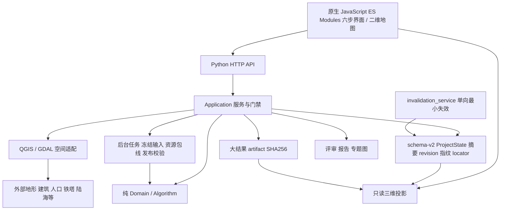
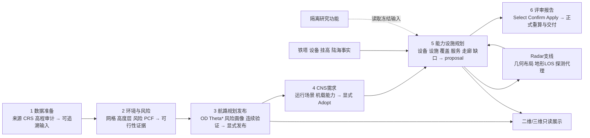
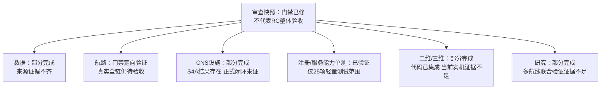

# 系统现状、模块状态与算法

适用：`9404d16` 加本次最小发布门禁修复的审查快照，2026-10-22。工作区其他修订与实验结果另列，不移用其验收。总体发布判定见 [00](00_BASELINE.md)，逐文件差异见 [05](05_EVIDENCE.md)。既有详细说明参考开发树 `docs/17`、`docs/18`，它们不属于候选原有提交。

## 总体架构

前端负责交互；服务负责业务编排和正式状态写入；算法处理纯输入输出；GIS 层解释真实空间文件。三维用于解释既有结果，不反向改变正式规划。revision 防止旧页面覆盖新状态，artifact 避免将海量结果塞进状态和快照。

## 六步流程与依赖

第 1 步确认数据含义；第 2 步区分软风险与硬约束；第 3 步候选需独立验证和人工发布；第 4 步明确飞行器究竟需要哪些服务；第 5 步评估现有能力并提出补点；第 6 步把评审选择转为正式方案并再评价。箭头是依赖，不要求每次全部重算。Radar 仅在相应需求下进入主链，不能替代 RID。

## 模块状态图与解释

| 模块 | 当前状态 | 通俗原理与证据边界 |
|---|---|---|
| 数据准备/来源审计 | 部分完成 | 登记文件身份与解释规则；rev523 有部分 verified，但人口/DSM 仍 configured_unverified |
| 环境/风险/PCF | 部分完成 | 风险给路径代价；PCF 给 pass/blocked/unknown。建筑证据与 C3 仍有业务限制 |
| 航路/连续验证/发布 | 部分完成；资格门禁定向已验证 | 原 `9404d16` 失败用例经最小补丁恢复；false/unknown/stale 被阻止、true 保留；不代表真实全链验收 |
| CNS需求 | 部分完成 | 推荐服务种类和强度，需 Adopt；当前端到端验收未重跑 |
| 覆盖/服务能力 | 部分完成；25 项中含能力契约已验证 | 几何命中只是位置关系，还需设备与机载证据；不能宣称现场无线可用 |
| P14/P15/P16/连续失保 | 部分完成 | 走廊离散评价→缺口→逐轮试算；S4A 实验仍有 219 残余，正式 A2 闭环未证 |
| 导航完整性监测 | 部分完成 | 单独评价导航监测关联；v2 等修改存在于未提交树，不能混作候选能力 |
| Radar/地形 LOS | 部分完成 | 扇区/几何布局和地形通视；不等于 Pd、RCS 或场测通过 |
| 评审/报告/导出 | 部分完成 | select/confirm/apply 分开；报告锁与披露还有未提交修订 |
| 二维/专题图 | 部分完成 | 空间结果可视化；开发树有额外制图修订，未全部纳入 |
| 三维 | 部分完成 | Cesium、地形/建筑、CNS站点和保护体只读代码已纳入；本轮未启动实机复验 |
| 状态/存储 | 部分完成 | 原子保存、revision 与外置 artifact；P16 七字段恢复补丁仍未提交 |
| 后台任务 | 部分完成 | 冻结输入→计算→指纹校验发布；不移用旧版本任务 PASS |
| 条件优化研究 | 部分完成 | 已有条件域、求解/评价/结构枚举代码；worker/评价又有未提交修改 |
| 多航线共享设施联合优化 | 证据不足 | 不能从单航线贪心或条件实验推断总体目标已完成 |
| 完整传播/现场服务认证 | 证据不足 | 尚无足够参数与测量证明；本轮不补算法 |

未发现足以将整个当前模块标为“已验证”的端到端证据；“代码存在”和历史 PASS 均不是当前验收。

## 核心算法清单

版本按本轮干净候选注册快照；非默认/研究分支不强行填注册版本。

| 名称 | 用途、输入 → 输出 | 实现文件（仓库相对路径） | 限制 |
|---|---|---|---|
| relative risk 1.1 | 人口、遮蔽等 → 相对代价 | `risk/v1.py`（注册入口）、`risk/factors_v2.py`、`domain/risk_v2.py` | 非事故概率/监管等级 |
| building clearance | 建筑、地面、航高 → 净空及证据 | `algorithms/building_clearance/v1.py`、`domain/building_clearance.py` | 预测高度不可自动当实测 |
| layered Theta* 2.1 | OD、固定巡航层、风险/PCF → 候选路径 | `layered_route_planner/theta_star_v2.py`、`feasibility.py` | unknown 默认不搜索；不包含完整进离场设计 |
| 连续路径验证 | 候选、空间事实 → verdict/问题段 | `validation/continuous_validators.py`、`application/layered_route_validation_service.py` | 发布另有资格/身份门禁 |
| geometric coverage 1.0 | 设备原点、几何模型、目标 → provider 命中 | `algorithms/coverage/geometric_3d.py` | 几何不代表服务 |
| service capability 1.0 | provider、设备模型、机载需求 → 能力/冗余 | `algorithms/service_capability/v1.py`、`domain/cns_service_registry.py` | 服务身份、站址数和独立 provider 不同 |
| corridor 1.4 | 航路、宽带、层、服务 → 体素走廊 | `algorithms/corridor/v1.py` | 固定宽度口径不能与旧版本混用 |
| corridor gap 1.3 | 走廊、需求 → 服务/冗余缺口 | `algorithms/corridor_gap/v1.py` | unknown 单列，不视作 pass |
| reuse-first planner 2.3 | 宿主×设备、缺口、限制 → 累积 proposal | `site_planner/corridor_reuse_first_v2.py`、`application/corridor_site_planning_service.py`、`domain/corridor_site_planning.py` | 贪心/分层试算，不证明全域最优；需 Apply 后正式评价 |
| timeline / protection 1.0 | 航迹、时间/保护规则 → 保障时间线/包线 | `algorithms/timeline/v1.py`、`algorithms/protection/v1.py` | 工程阈值需来源，不是法规认证 |
| manual requirement 1.0 | 人工规则 → Required CNS | `algorithms/requirements/manual_v1.py` | 推荐不具权威；须 Adopt |
| Radar layout / MILP | 合格塔、扇区、目标 → 布局/不可行证据 | `algorithms/radar_layout/v1.py`、`milp.py`、`candidates.py` | 探测代理与地形 LOS 不等于真实探测保证 |
| terrain LOS | DEM 剖面、原点/目标 → 通视证据 | `domain/radar_terrain_los.py`、`gis/radar_terrain_los_adapter.py` | 无完整传播/建筑遮挡保证 |
| 条件优化/结构枚举 | 冻结研究域、评价预算 → 条件解/证明范围 | `algorithms/existing_site_lexicographic/`、`algorithms/joint_feasibility/`、`application/research_real_c_evaluator.py` | 仅条件域结论；未提交 worker 差异另审 |

表中 `algorithms/`、`domain/`、`application/` 等均位于 `cns_planner/` 下。精确注册 ID、版本和默认选择以 `tools/registry_snapshot.py` 为准。

## 当前问题（按影响）

| 优先级/类别 | 问题 | 下一项可验证动作 |
|---|---|---|
| 已解决（本快照范围） | 基础提交候选资格门禁缺失 | 本次最小移植及 101 项相关回归通过；保留真实场景验收待办 |
| P0 工程 | 近期验收源码未全部入 Git，实验结果缺提交身份闭环 | 建立源码差异 manifest + state/artifact 指纹 |
| P1 数据 | 建筑覆盖与高度证据、C3 来源未闭合 | 受影响范围增量核查，保持 unknown |
| P1 数据/业务 | 塔原点、物理挂载和设备真实性证据不足 | 登记场勘/参数来源，保留 conditional |
| P1 算法应用 | RID 219 残余及 131 ALT-150 空进展待复现 | 固定输入只读内存最小复现，勿先改规则 |
| P1 工程 | P16 外置恢复、报告锁/披露修订尚未提交 | 分别审查恢复/导出契约，避免丢证据 |
| P2 展示 | 2D/3D/专题图版本与实机证据不统一 | 只读展示一致性核验 |
| P2 研究 | 多航线、成本与独立性评价未形成可复现闭环 | 先稳定单航线再申请研究实现 |

独立只读复核未发现发布绕过；两个服务与验收树来源逐字节一致。非阻断展示残留：readiness_snapshot 尚未共用新增身份/资格检查，可能显示 eligible，但 Preview/Apply 会重新检查并拒绝。后续仅需单独对齐提示，本次不扩大移植。
