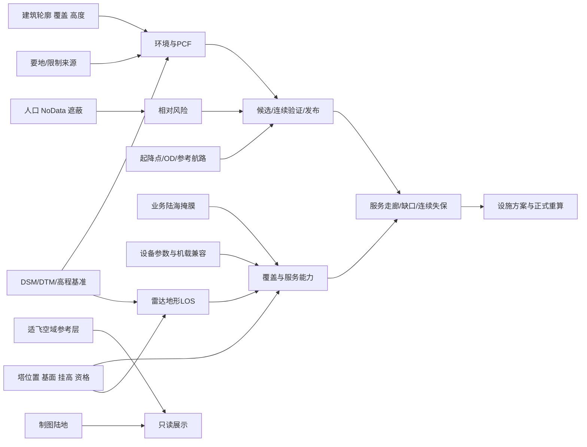

# 数据质量、版本与消费依赖

适用：`9404d16` 加本次资格修复的代码审查快照及明确标识的 S4A rev523 实验输入。2026-10-22。本轮未重新清洗数据、未遍历原始数据目录；复用提交内 checkpoint manifest，并对已知实验 state/结果做只读增量核对。完整来源审计摘要见 [05](05_EVIDENCE.md)。

**证据口径**：确认事实=本轮读取或受限测试直接证明；工程估算=显式模型/人工工程裁定；未知=没有足够独立证据；无效=已证明某种用途不成立。`source_type=real` 或 `verified` 字段本身不是现实精度认证。

## 数据登记

所有“登记 SHA”均为既有 manifest 或 rev523 来源审计值；本轮没有重新 hash 原始 GIS 文件。新算 SHA 仅限 00 中明确列出的两份 state 和一个结果文件。研究范围为舟山业务场景，以下没有填出未经核实的数值 bbox。

| 数据 | 来源/版本与登记 | 坐标及高程基准 | 覆盖/缺失与实际消费者 | 质量结论 |
|---|---|---|---|---|
| 地形 DSM | registry 的 terrain；既有 GLO-30 语义；rev523 configured_unverified，无 SHA | 声明 EPSG:4326；本轮未证其垂向元数据 | 定量范围未核；地形、环境/PCF、剖面；不可用 DEM NoData 推断海洋 | 未知：来源审计未闭合 |
| 地面 DTM | `Zhoushan_FABDEM_DTM_30m.tif`；checkpoint 65,656,187 B，rev523 同 SHA | 声明 EPSG:4326；工程采用正高语义，实际文件垂向证据另核 | 建筑地面/原点、三维地形；覆盖 bbox/NoData 本轮未重扫 | 文件身份有登记；精度和场勘未知 |
| 建筑单体 | `zhoushan_buildings_v3.gpkg`；checkpoint 466,837,504 B，rev523 同 SHA | EPSG:4326 经项目内部确认；非测绘认证；高度证据另列 | 建筑净空、PCF、展示；不能用“有建筑命中”证明整格建筑覆盖完整 | 部分可信；预测高度、几何修复/覆盖盲区需逐用途审查 |
| 建筑 L8 网格 | `zhoushan_building_grid_L8_v3_heightstats_v1.gpkg`；58,105,856 B | EPSG:4326 内部确认；高度统计不等于逐栋真值 | 风险/热力图/环境；不能替代独立建筑净空事实 | 身份有登记，完整性与高度质量仍未知 |
| 人口 | rev523 configured_unverified；SHA 未登记 | 声明 EPSG:4326，无高程适用 | 人口数/整格密度/有效观测密度、风险；NoData 与零人口分开 | 未知：分母和海域策略必须显式，不能缺失补零 |
| 陆海掩膜 | rev523 verified，SHA 见下；制图陆地另为 configured_unverified | 声明 EPSG:4326；海岸不确定带需保留 | 服务半径/冗余、Radar surface；展示陆地不参与这些判定 | 来源有登记，岸线精度/时效本轮未认证 |
| 铁塔 | 真实塔来源登记 SHA，rev523 verified；373 宿主见实验记录 | EPSG:4490 内部确认；原点=地面/基面+挂高，需防重复加屋顶/塔高 | 障碍、共塔候选、Radar；历史准备曾 373→20 裁剪 | 工程条件化：77 confirmed / 296 estimated 原点（历史记录）；均非物理挂载确认 |
| 空域 | QGIS/basemap，configured_unverified，无 SHA | CRS、时效和法规来源未知 | 适飞空域严格仅 display_only_reference_layer；其他受控约束需单独身份 | 适飞图不可用于风险/搜索/readiness/CNS；不是可飞许可 |
| 要地/C3 | 独立来源与规则未就绪的历史 unresolved | CRS/范围/版本未知 | PCF、真实航路连续验证 | 业务阻塞证据不足，不能自动 pass |
| CNS 设备/既有设施 | registry 默认 devices 为 synthetic；参考资料库为 real/reference_only | 设施位置/挂高按实例来源，设备无统一地理基准 | 几何、服务能力、走廊/P16；频段、功率、天线、灵敏度、机载兼容缺证 | 模型可用于条件筛选；不能称真实在役服务；S4A 参考资料有 SYN 对象 |
| 起降点 | rev523 reference_landing_sites verified，SHA 见下 | EPSG:4490 为人工工程解释，未获提供方正式声明 | 参考集合→人工选择→项目 OD；坐标低置信/重复等保留 | 工程可用有条件；不能由 CRS 确认推导位置/许可准确 |
| 航路 | scenario/operational/reference 分容器；rev523 输入身份见 00 | 二维经纬路径与 EGM2008 正高层分开；不写混第三维 | 航路、CNS走廊、报告；参考航线不自动正式发布 | 本快照发布资格门禁已定向修复；进离场、建筑/C3 证据仍需核 |

## 可复用校验值

| 数据 | 已有登记 SHA256 | 证据出处 |
|---|---|---|
| FABDEM DTM | `21406bd901fbebae211528a158ca95eef899e2074322625717b215b13d8799b8` | 候选 `docs/checkpoints/phase36_pre3d_data_manifest.json` + rev523 |
| 建筑单体 | `4f1657495d8422ac0d23973949d4bcbca59dcf07d59ed380ff9877afc7391b97` | 同上 |
| 建筑网格 | `13fca1ee7183035a280ad066f84a6d116303e0b3797c206bdfd98f7e50bbce37` | 同上 |
| 铁塔 | `d722c111596acb4766bcc9d4cb5ce326f3a4b1f8364a5db871cb60220e2a411b` | rev523 source_audits |
| 陆海掩膜 | `fe7918c96636178b7931b3f6887e2755db191dc6fce51ad0c5b5bfcbb6180aef` | rev523 source_audits |
| 参考起降点 | `55b60344d5cc9eef0acef285e33ee15e3e77a3ee8e39bedc62d095cc1c3cc0e5` | rev523 source_audits |

checkpoint 中的 state SHA `92a0000f…` 属于更早 checkpoint，不是 rev523 的 `dc81637d…`。禁止把 checkpoint 数据登记误当最新 state 验收。

获取方式：向项目负责人取得允许使用的数据及来源/许可说明，按登记 SHA 校验，配置本地数据路径，再运行来源审计和目标范围覆盖检查；不将私有路径、Key、原始 state 或大数据纳入 Git。建筑数据存在 CC BY-NC 4.0 授权提示，未经确认不转分发。空仓库 clone 不能独立复现真实场景，manifest 已明确 `clone_ready_without_external_data=false`。

## 消费依赖

## 三个最优先数据风险

1. **建筑覆盖/高度证据和 C3 缺失可阻塞真实航路发布。** 重点核对“无命中”是否因缺覆盖、无效几何或缺高，而不是直接解释成净空安全；只做航路影响范围增量检查。
2. **铁塔可选资格与真实可安装性不同，设备真实性也不齐。** 真实塔清单不证明可挂载；planning origin confirmed 不等于 physical mount confirmed；设备模型和资料库不能混用。
3. **服务与连续保障结论依赖未确认假设。** RID 陆地/海岸有效半径 2000 m，包络/设备名的 2500/5000 m 不能代用；两新点 origin=0 结果不是地面部署方案；distinct site 不等于 independent provider。

明确无效的用途：用旧 2500/5000 m 二维组合断言当前冻结 RID 方案可行；用 0 m 正高新点的几何 219/219 断言可安装；把 45 m / 3 s 写成通用法规。后者仅为工程基线，且 45 m=3 s 依赖 15 m/s。unknown 另报，不作为已证失保或恢复服务。

本轮不认证数据全域覆盖、实际设备性能或现场建设可行性；这些未知项即下一轮规则/证据清单，而非可静默填补的默认值。
