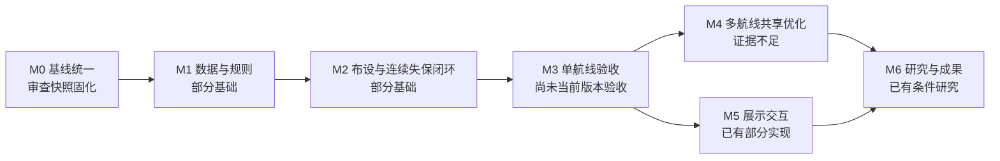

# 开发路线与任务优先级

目标：可复用的舟山区域多航线 CNS 设施联合优化规划研究平台。适用：2026-10-22 R0 审查；当前为 `9404d16` 加最小资格修复的**审查快照，非 RC 验收**，各阶段均不据此宣告完成。M0–M6 是本轮建议编号，不等同既有 R38 文档的 M 编号。详细已有研究入口保留，不重复开发已验收能力。

本轮仅做路线设计。AGENTS 限定 Phase 4 冻结 RC；既有文档提出 Phase 4.5/Phase 5，后续新算法/联合优化实现需负责人明确阶段授权。顺序不是刚性瀑布：M5 可在不改权威状态前提下与其他阶段并行安排。

## 分阶段计划

| 阶段/业务目标 | 当前基础与前置依赖 | 待完成任务 | 可验证完成标准 | 主要风险 | 学习内容 |
|---|---|---|---|---|---|
| M0 统一基线 | 有精确候选、原始实验身份；资格门禁已最小修复、101项回归通过 | 本轮仅固化资格修复和审查快照；后续登记正式 state/数据/算法/artifact及必要恢复/报告修订 | 干净 clone/工作树能解析注册表，定向回归过，远端 SHA 等于本地，验收证据绑定同输入 | HEAD 被误当执行源码；秘密/受限资料混入历史 | Git 对象与工作树、指纹、最小复现 |
| M1 关键数据与规则 | 来源审计、建筑/人口/陆海语义已有代码；依赖 M0 | 增量查建筑覆盖/高度、C3、塔原点/资格、设备/机载来源；登记连续性阈值和速度 | 每个必要数据有来源、版本/hash、CRS/垂向解释、目标覆盖结论；未知不被默认为 pass | 人工工程解释误当测绘/法规认证 | CRS/正高、NoData、误差与证据分级 |
| M2 布设与连续失保闭环 | P14 1.4/P15 1.3/P16 2.3；S4A 局部改善；依赖 M0–M1 | 131 ALT-150 最小内存复现；核设备能力合并与站址计数；真实 DEM+挂高替代 origin=0；按授权 Apply 后重算 | 同源阈值下 proposal 与正式重算可对照；报告确认/可能失保及 m/s，残余/unknown 可追溯，不要求人为做成全 pass | 服务身份混用；站址与 provider 独立性混淆；计算与写入范围失控 | 冗余、服务判定、离散投影连续失保 |
| M3 单航线完整业务验证 | 有冻结版六步历史预验收和真实单线实验；依赖 M2 | 选一条有明确来源 OD，完成数据→发布→需求→方案→报告；保存重开、stale、任务恢复检查 | 同一源码 SHA/state/输入下六步验收；报告含限制和残余，保存重开身份不漂移；满足条件与未知分开 | 只证明算完，未证明可发布/可追溯 | 业务门禁、状态机、分层验证 |
| M4 多航线共享设施优化 | 有条件域求解/评价和共享站址相关代码，未证多线整体验收；依赖 M3及新研究授权 | 先核现有研究成果；定义≥3条经来源审查航线、共享计数/成本/独立性、联合目标；对照单线合并与现有启发式 | 固定数据/预算可重现；共享设施无重复计费，逐线约束/残余可追溯；最优性声明限于证明域 | 组合爆炸、真实参数不足、条件最优夸为全局最优 | MILP/离散优化、多目标、下界与可行性证书 |
| M5 二维三维及交互 | 候选已集成多项 3D 与只读投影；依赖稳定数据/结果契约 | 修现有显示偏差；二维/三维/报告同源；unknown/stale/假设醒目；预算和离线行为核查 | 只读前后 state 指纹不变，同一对象/高度/服务一致，资源包线内实机验收 | 显示圈被当服务范围；影像授权/预算 | GIS投影、只读模型、浏览器性能 |
| M6 毕设研究与成果 | 有研究目录、结构枚举/受控实验；依赖 M3，联合课题依赖 M4 | 整理问题定义、基线对照、消融、敏感性、失败例、参数来源、复现包与论文图表 | 每项结论绑定输入/版本/预算；可复现至少一个对照；披露 unknown/条件性，不伪造性能与法规结论 | 数据受限、不可复现、样本/计算预算不足 | 科研设计、统计/敏感性、论文证据表达 |

## 下一轮任务表

| 优先级 | 任务与交付 | 依赖/验收 | 边界 |
|---|---|---|---|
| 本快照已处理 | 候选发布资格/身份最小修复与直接测试 | 原失败已复现并恢复，101项相关测试通过；unknown/stale及直接Apply检查生效 | 不等于RC整体验收 |
| P0-2 | 同时确定 P16 外置恢复与报告证据必要补丁集合，建立新基线 manifest 并安全发布 | state/artifact roundtrip；逐文件审查；完整发布门禁和远端 SHA | 先负责人裁定，不在本轮继续实现 |
| P1-1 | 锁定 rev523 源码与输入，复现 131 ALT-150 confirmed 空进展 | 最小内存调用记录几何→设备合并→能力→合格站址首个分歧 | 不重跑昂贵全量 P14/P15/P16；不改规则求通过 |
| P1-2 | 航路范围建筑/C3 与宿主/设备证据补齐 | 有来源、hash、覆盖/高程与未知清单 | 不清洗全域，不冒称实测 |
| P1-3 | 经授权完成 S4-A2 正式应用后评价 | proposal 与真实 Apply 后 P17 同源对照 | 需明确正式/实验项目和写入范围 |
| P2 | 单线完整验收，再安排多线研究和展示优化 | M3完成标准 | 避免重复开发已有 3D/研究代码 |

后续最值得先做的三件事是：**审查尚未合入的必要恢复/报告补丁并统一验收输入；绑定 rev523 身份并复现 131 计数问题；增量确认建筑/C3、挂高和设备证据**。它们先解决“版本可信、结果可解释、输入可用”，再进入新增研究。

需负责人决定：必要补丁范围与新 SHA；正式输入身份；工程阈值/设备资格/数据许可；S4-A2 写入授权；Phase 4 冻结与后续研究授权边界。本轮结束后等待审查，不启动表中任务。
