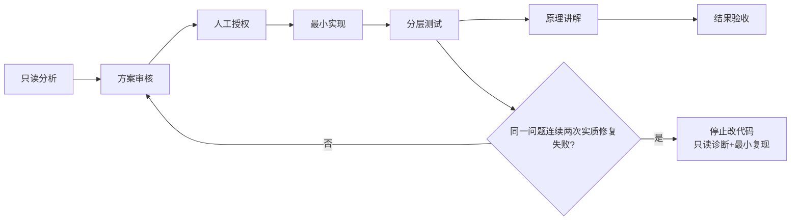

# 本地 AI 开发、验收与学习规范

适用本仓库后续工作。用户指令与 AGENTS.md 优先；本规范不自行授权状态变更、算法变更或发布。面向用户使用简体中文，标识符保持英文。



1. **只读分析**：先检查唯一工作区/HEAD/dirty、实际执行树、state revision、数据与算法指纹。用 rg 精确定位源码、合法 production writer 与既有测试；不按日期挑版本，不整读历史归档。
2. **方案审核**：说明问题、根因证据、最小改动文件、兼容性、失效边界、定向测试与失败退出条件。未知保留未知；设计稿不算实现，代码不算验收。
3. **人工授权**：确认本轮业务与状态写入范围。已有明确授权不重复询问；超出范围、新算法/数学语义、正式 Adopt/Confirm/Apply 或无法确定的权威版本必须先交负责人裁定。待批时继续不依赖审批的只读工作。
4. **最小实现**：优先隔离工作树，保护现有修改；API→Application→Domain/Algorithm；空间数据经 GIS；不绕过 service 改 state。算法语义若获授权变更，显式版本化并同步指纹/staleness。
5. **分层测试**：纯领域/契约→服务/状态/外置恢复→前端模块与语法→必要真实 QGIS/HTTP→人工业务验收。仅跑受影响范围；新增轻量文档无需伪造业务重跑。历史 PASS 绑定原身份，不挪用。
6. **原理讲解**：解释输入如何转成判断，几何/能力/现场证据的差别，以及每项结果的适用边界。同步代码/文档默认版本，避免两套公式。
7. **结果验收**：提供源码 SHA、输入 revision/hash、命令/输出、剩余 unknown、artifact locator 及人工观察点。用户验收通过与否明确记录；计算完成不等于业务达标。

## 两次失败止损

同一问题连续两次实质性修复失败，立即停止继续补丁试错，转为只读诊断：锁定输入和执行身份、建立最小复现、比较预期/实际、找第一个证据分歧，提出一个可证伪假设后等待审核。环境权限错误不冒称产品失败；测试失败不通过扩大改动掩盖。不要改阈值、补零或放宽 unknown 门禁以获得 PASS。

## 本机测试和提交

Python 固定：

```powershell
D:\tools\anaconda\python.exe -m pytest -q -x --tb=short -p no:cacheprovider tests/test_<相关>.py
```

权限/setup 失败先按 README §16 使用工作区 TEMP/--basetemp。前端无构建步骤：`node tests/<相关>.test.mjs` 与受影响入口 `node --check`，不跑通配全量。真实 QGIS HTTP 仅在服务就绪且明确启用时执行；禁止默认全量 Theta*/P14/P15/P16 重算。

交付前检查任务 diff 和 `git diff --check`；JSON/YAML UTF-8 无 BOM，中文 PowerShell 5.1 脚本保留 BOM；配置变更另跑 `tools/remove_config_bom.py --check`。仅显式授权时 commit/push，逐文件 stage 并复核暂存内容、体积、来源许可与待上传历史秘密；不使用 add -A、force、reset、clean、rebase 覆盖成果。审查分支不自动合并 main。

## 每轮技术报告必须回答

| 问题 | 必需内容 |
|---|---|
| 为什么做 | 用户业务影响与优先级 |
| 以前怎么做 | 旧行为、限制及可复现例子 |
| 现在怎么做 | 实际改动与状态写入边界 |
| 技术原理 | 通俗解释关键公式、算法或门禁 |
| 验证证据 | 版本、输入、定向测试、人工观察；明确未验证内容 |
| 我需要学习的知识 | 本轮相关概念、源码入口和建议练习 |

报告不倾倒超长日志；详细证据保存在 Markdown。若被阻塞，写清已完成项、未完成项、具体证据和需要裁定的问题，然后停止业务开发。
