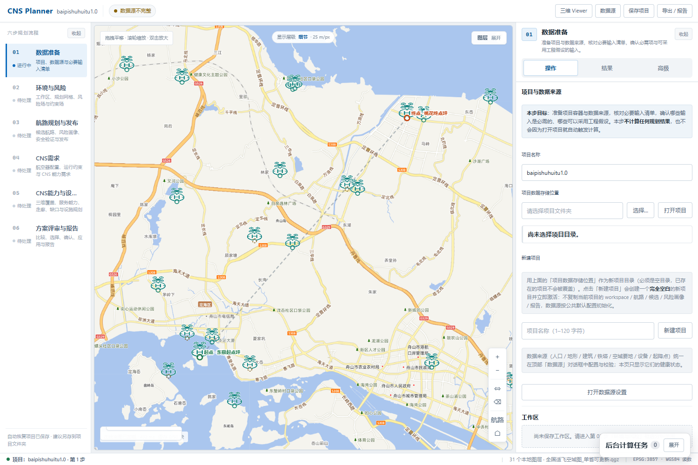
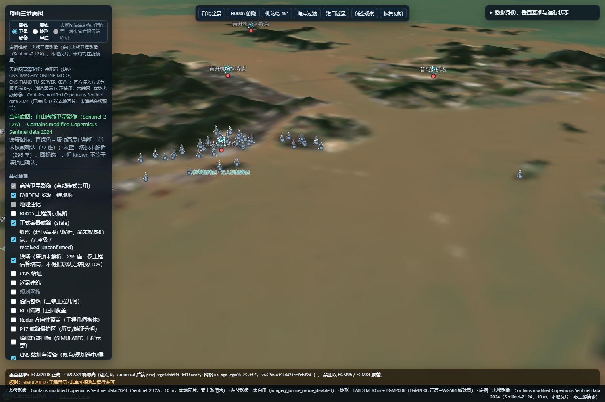

# R7-D16 E 批前端、三维与起降点图标完整集成

基线 `8f1c927c7df7d3f18286526e9a888ca07c9d9d7f`（R7-D15），分支
`codex/r7d13-ab-integration`。执行位置为用户明确授权的既有 R7-D13 隔离工作树
`C:/Users/yiding/.codex/worktrees/r7d13-ab-integration/CNS-PLANNER`，作为 AGENTS.md
单工作区约定的本轮限定例外；`D:/Projects/CNS-PLANNER` 主工作区保持原状。未 push、
未合并 main、未 reset/clean、未清理任何历史工作树。

代码提交：`a5ba3a2644aada75113c8ed3404ab6a3953ed49d`。
证据目录：`docs/r7d16/`。

---

## 一、结论

**E 批 PASS（限定于本报告列出的范围）**：

- 四个冲突文件已逐函数协调，A/B 单次 POST、后台任务恢复、项目切换锁、显式采纳与
  状态隔离全部保留；C 批 GIS/Radar、D 批 CNS/P17 `2.5` 语义未回退。
- 固定 1000 m 走廊几何、导航监测和三维只读 API 已接回；前端不重复计算几何。
- 指定起降点 PNG（SHA256 `37f83a99…`）已进入统一静态资源，二维 marker 与 Cesium
  billboard 共用同一张图；真实浏览器截图见 `shots/`。
- 19 项受保护三维图层开关全部保留（另新增 1 个默认关闭的起降点图层，共 20 个），
  默认关闭状态、13 个 manifest 图层、离线影像、FABDEM 地形均通过真实浏览器核对。
- 二维/三维页面控制台 0 错误、HTTP 4xx 0、无重复 POST；请求计数符合“单次 GET +
  任务轮询”的既有口径。
- Theta* `no_path` 差异已做最小只读归因：属**测试夹具早于端点过渡策略**，不是 E 批
  或 Theta* 几何/门禁回归；未改算法、未放宽约束。

**PASS 不覆盖**：完整 Step01–06 真实项目验收、全量 pytest、QGIS 8765/8776 在线
验收，以及本报告“剩余条件”列出的基线既有失败。

---

## 二、E 批四文件逐函数协调

### 1. `cns_planner/api/router.py`

以本轮集成分支的 A/B/C/D 端点为底座，按 E 批清单装配，而不是整文件 our/theirs
覆盖：

- 保留 A/B：`/api/source-audits/verify` 仍走 `_task_submit("source_audit_verify", …)`，
  来源在 `_freeze_runtime_sources` 与 `_task_submit` 双重冻结；B 批任务来源拒绝逻辑
  （`_TaskSourceRejected`）原样保留。
- 保留 C/D：Radar LOS、PCF、连续服务、评审/报告、P16 端点与本轮 D15 的 2.5 语义
  未改写；`/api/compatibility/catalog` 未删除。
- 新增 E 端点：`GET /api/fixed-corridor-geometry`、`GET /api/cns-shared-site-candidates`、
  `GET /api/visualization-3d/*`（白名单 + ETag/304 + 地形/影像/晕渲代理）、
  `POST /api/navigation-monitoring-simulation`、`POST /api/cns-corridor-site-plan/v2/evaluate`。
- `Response` 增加可选 `headers`（既有 `api/server.py` 已按 `response.headers` 透传），
  静态资源 MIME 补 `.png/.json/.svg/.woff2`，保证 Cesium/PNG 不再以
  `application/octet-stream` 返回。
- 三维路由段与本轮来源 `2b953bf`（R7-D3C）逐行一致；`docs/r7d16/verify_assets.py`
  以 LF 归一化校验段身份 `2e8aa162…` 通过。

### 2. `cns_planner/web/js/main.js`

- 保留本分支唯一状态写入路径：所有快照安装/刷新仍经
  `applyWorkflowSnapshot` / `applyProjectState`；没有绕过 `flow` 直接写入。
- 保留 A/B：`submitBackgroundTask`、任务恢复、项目切换串行化、
  `resetProjectMapState` 状态隔离。
- 接回 E：三维 Viewer 入口、导航监测只读状态/图层/命中、铁塔统一 PNG 预加载、
  P16-V2 只读卡片投影与起降点 PNG 预加载。
- 项目打开阶段保留 D9 的显式超时（request/snapshot）与 `activating` 阶段；这只
  收口前端生命周期，不改后端语义。

### 3. `cns_planner/web/js/workflow/step05_cns.js`

- 结果分段顺序保留 Round32-H：覆盖 → 能力 → **雷达基线** → 服务走廊 → 缺口 →
  设施 → 连续服务；在末尾新增「导航监测规划」，因此 Radar 仍先于 P14/P15/P16。
- 删除并回冲突中重复出现的第二份「雷达监视规划」段，保证 `cns-res-radar` 唯一。
- 导航监测面板、参数、只读仿真提交与阻塞项接入；P16-V2 只读预算卡片接入；
  `document` 级取消委托增加环境守卫，Node 测试桩不再因缺少 `addEventListener` 抛错。
- 雷达策略保存恢复 `ground_site_installation_heights` 逐站采集，但不新增/回写
  `allow_mixed_radar_types`，保留 Round31-C 的 I-only/严格升级语义。

### 4. `tests/workbench_shell.test.mjs`

- 结果分段合并为 8 段（含导航监测），走廊索引按“Radar 在前”校正为第 4 段。
- Step04 固定 1000 m 走廊改为三个只读控件（`corridorHalfWidthReadOnly`、
  `corridorTotalWidthReadOnly`、`corridorWidthPolicy`），不再允许通过 DOM 改写宽度。
- Step02 增加 `saveConstraintConfiguration` 的既有动作登记；NoData 未确认状态词按
  中文界面断言为「未配置」。
- CSS 检查只匹配真实 `!important;` 声明，并登记 `map.css` 图例收起态
  `height:auto !important` 这一条有注释的例外。

---

## 三、必要依赖装配

来自 R7-D3C/D9 且本轮实际接回（均按需、只读）：

- 三维后端：`visualization_3d_service`、`visualization_3d_imagery_service`、
  `visualization_3d_{communication_volume,intrusion_contract,protection_volume,radar_volume,rid_footprint,sites}`、
  `cns_3d_site_projection`、`assumption_sites_3d`、`flight_protection_research`、
  `imagery_budget`。
- 三维 GIS：`terrain_tile_adapter`、`terrain_window_adapter`、`offline_imagery_adapter`、
  `egm2008_geoid`、`relief_tile_adapter`、`water_mask_adapter`。
- 三维前端：`visualization-3d.html`、`tiles.js`、`js/visualization3d/*`（9 个原有模块 +
  assumption/research/landing_pads）、Cesium 运行时 8 文件。
- 导航监测：`navigation_monitoring_simulation_service`、
  `domain/navigation_monitoring_simulation`、`workflow/navigation_monitoring.js`、
  `map/navigation_monitoring_overlay.js`。
- 组合根：`WorkflowService` 构造并注入候选适用性/风险画像；`ApplicationContext`
  注入 `navigation_monitoring_provider` 与 `shared_site_candidates_provider`（只读）。
- 独立验收端口：`map_server.listen_address()` 支持 `CNS_MAP_PORT`，默认仍是
  `127.0.0.1:8765`；本轮用 8793，未触碰 8765/8776。

---

## 四、固定 1000 m 走廊、导航监测与三维只读 API

- `GET /api/fixed-corridor-geometry` 复用本轮唯一的 `FixedCorridorGeometryService`；
  几何只由 W1A 构造器产生，无几何时 fail-closed（blocked/unavailable），前端不画近似边界。
- Step04 的水平宽度改为只读固定契约展示；提交端不再读取半宽输入，服务端一律消费
  `fixed-1000m-v1`。历史非 500 m 值只读保留并标 stale。
- `POST /api/navigation-monitoring-simulation` 是**只读仿真**：不写 ProjectState、
  不解锁评审；响应状态严格区分 `simulation_planned / reused_existing / blocked /
  stale / unknown / not_evaluated`。
- 三维端点全部 GET、零写入、带 ETag/304；地形/影像/晕渲有独立缓存策略；
  固定保障带只在后端 `currentness=current` 时按 current 绘制，否则只允许明确标注的
  历史预览或 fail-closed。

---

## 五、起降点 PNG（二维 + 三维同源）

| 项 | 值 |
|---|---|
| 源文件 | `D:/浏览器下载内容/无人机停机坪图标.png` |
| 入库路径 | `cns_planner/web/assets/symbols/landing_pad.png` |
| SHA256 | `37f83a99215bc49670b22ec5e6c700a583dc99c6d963536f133d25e40365e76b` |
| 字节 | 641,213 |
| 二维引用 | `display_layers.js` 的 `LANDING_PAD_ICON_URL` |
| 三维引用 | `visualization3d/landing_pads.js` 的同一 URL |
| 预加载 | `main.js` 只预加载一次；图片未就绪回退既有 diamond/circle |

实现要点：

- **不改几何/身份**：仍以原 `node_id` / `reference_site_id`、原经纬度和原点击详情
  为准；PNG 只改变标记外观。
- **透明边缘**：二维绘制期按 `alpha>8` 的内容包围盒裁剪（`getImageData`），不修改
  原始 PNG 字节；三维由 Cesium 原生 alpha 处理。
- **锚点**：二维与三维均底部锚定，图标只向坐标上方生长；锚点处保留身份环。
- **起点/终点**：只读取唯一权威运行航路（`canonical_operational_route`）的首末点；
  起点绿环 + `起点 ·` 前缀，终点橙环 + `终点 ·` 前缀；航路不唯一时只按身份着色，
  绝不按名称或距离猜。
- **缩放**：二维按 LOD detail 30 / medium 24 / overview 18 px；三维用
  `NearFarScalar` 距离缩放，并限制 40 km 显示距离。
- **业务身份**：参考起降点青绿色环、项目起降点常规橙色环；`blocked` 只进状态与
  弹窗，不改身份配色。

截图：

---

## 六、19 项受保护三维交互验收

`docs/3d-protected-assets-r7d3c.json` 的 19 项源码：**16 项逐字节一致**；
3 项为 E 批有意变更，且均为 additive：

| 文件 | 变更原因 |
|---|---|
| `cns_planner/api/router.py` | E 批端点装配；三维路由段仍与 R7-D3C 逐行一致 |
| `visualization3d/app.js` | 新增起降点 PNG billboard 图层与验收统计 |
| `visualization3d/basemap.js` | `landingPads` 默认关闭 |

19 个受保护图层开关（+ 新增起降点图层 = 20）在真实浏览器中逐一开关，
**全部无控制台错误、无 HTTP 4xx**；默认状态为仅影像/地形开启，其余全部关闭：

| # | 图层开关 | 默认 | 验收结果 |
|---:|---|---|---|
| 1 | 高清卫星影像（离线模式禁用） | 开 | 离线模式禁用在线影像；离线影像可见 |
| 2 | FABDEM 多级三维地形 | 开 | `terrain_provider=Dh`，地形瓦片 200 |
| 3 | 地理注记 | 关 | 开关无错误 |
| 4 | R0005 工程演示航路 | 关 | 测试项目无 demo 航路，空但 200 |
| 5 | 正式容器航路 | 关 | 测试项目无正式航路，routes 200/0 |
| 6 | 铁塔（已解析未确认） | 关 | 373 座统一 PNG billboard |
| 7 | 铁塔（塔顶未解析） | 关 | 同上；known=0 / unknown=373 |
| 8 | CNS 站址 | 关 | `cns-sites` available，846 实体 |
| 9 | 近景建筑 | 关 | 开关无错误 |
| 10 | 规划网格 | 关 | 开关无错误 |
| 11 | 通信包络 | 关 | 空但 200 |
| 12 | RID 陆海非正圆覆盖 | 关 | 空但 200 |
| 13 | Radar 方向性覆盖 | 关 | 测试项目 blocked，空但 200 |
| 14 | P17 航路保护区 | 关 | `not_calculated`，空但 200 |
| 15 | 模拟轨迹目标 | 关 | 开关无错误 |
| 16 | CNS 站址与设备四类身份 | 关 | 846 实体 |
| 17 | P16-V2 假设站址 | 关 | 无已完成 V2 任务，空且不伪造 |
| 18 | 飞行保护区（工程假设） | 关 | `blocked`，不伪造几何 |
| 19 | 固定 1000 m 保障目标带 | 关 | 无正式航路 → `unavailable/0`，fail-closed |
| + | 起降点（项目 + 参考，R7-D16 新增） | 关 | 100 billboard（2 节点 + 98 参考） |

13 个 manifest 图层齐全：
`terrain_fabdem`、`route_geometry_demo`、`route_geometry_canonical`、`towers`、
`cns_devices`、`cns_facilities`、`communication_volumes`、`rid_footprints`、
`radar_volumes`、`protection_volumes`、`cns_site_identity`、`fixed_corridor_band`、
`simulated_intrusion`。

资产核对详见 `docs/r7d16/3d-assets-verification.json`；Cesium 运行时按
`tests/test_cesium_vendor_license.py` 的**上游 LF 原始字节**重新物化，并用
`.gitattributes -text` 固定，避免 Windows checkout 改变证据身份（R7-D3C 清单里的
CRLF 哈希是当时工作树字节，两者行内容一致）。

---

## 七、真实浏览器验收

- 独立服务：`http://127.0.0.1:8793`，项目为工作树内测试副本（revision 21）；
  未启动、停止或触碰 8765/8776，未打开正式 ProjectState。
- 浏览器：Playwright Chromium（Microsoft Edge 通道），1500×1000，headless。
- 二维：控制台错误 **0**、HTTP 4xx **0**；导航监测/参考起降点/铁塔图层默认关闭。
- 三维：控制台错误 **0**、HTTP 4xx **0**；20 个图层开关逐一开关无错误；
  地形/离线影像/铁塔/站址/起降点均实际渲染；`entity_count=946`（含 373 铁塔、
  100 起降点、846 站址实体中的可见部分）。
- 请求纪律：二维 `state/project/active` 等各 1 次，`/api/tasks` 仅轮询；三维每个
  图层端点各 1 次；`manifest` 2 次是“摘要 + 铁塔明细”的设计内两次，`terrain-window`
  2 次是“首屏 + 固定带”，均非重复提交。无重复 POST。

结构化证据：`docs/r7d16/browser_evidence.json`。

---

## 八、Theta* `no_path` / `candidate` 差异归因

- 用例：`tests/test_phase4_b3x_planning_constraints.py::test_theta_star_and_supercover_never_cross_blocked_constraint_cells`。
- 现象：3×3 合成网格，阻挡中间格后应绕行，实际 `no_path`。
- 归因：不是几何/LOS/约束门禁算错；绕行唯一可行几何是从上方/下方进入终点格后
  **90° 转向**精确终点，而 Theta* V2 默认端点过渡可采纳性门限是 **45°**，且 goal
  标签到达 target anchor 后不再继续展开。45°/60° 时两个 goal 的
  `arrival_admissible=false`；显式 90° 时立即得到 `candidate`，路径
  `[[0.5,1.5],[1.5,2.5],[2.5,2.5],[2.5,1.5]]`。
- 基线 `8f1c927` 同一用例同样 `no_path`，因此**不是 E 批回归**，也不是本轮代码
  引入的算法回归；分类为“测试夹具早于端点过渡策略”。
- 本轮未改 Theta*、未放宽约束、未执行耗时正式规划。完整 Step01–06 前需由算法/测试
  owner 决定更新夹具或显式声明 90° 前提。详见 `docs/r7d16/theta_attribution.json`。

---

## 九、定向回归结果

| 组 | 结果 |
|---|---|
| E 批 Node（11 文件） | 199 通过 / 0 失败 |
| E 批 Python（24 文件） | 329 通过 / 0 失败 |
| A/B 定向 Python（14 文件） | 265 通过 / 1 skipped / 3 失败 |
| C/D 定向 Python（15 文件，含 D2/D4/D7/D8、P14–P18） | 299 通过 / 14 失败 |
| Node A/B/C/D 广泛回归（29 文件） | 26 文件通过；3 文件失败 |

**关键点：A/B 的 3 项、C/D 的 14 项、Node 的 3 个文件均在基线 `8f1c927` 的只读
git archive 快照上逐项复现为同一失败集合**，没有新增失败。已知失败族包括：

- A/B：`test_corridor_async_result_matches_sync_semantics`、
  `test_p14_protected_files_are_byte_identical`、项目持久化字符化用例；
- C/D：建筑层级独立事实（1）、旧风险模型/风险 V2 积分（2）、连续服务可接受性（4）、
  V3 连续建筑净空（7）；
- Node：`frontend_modules`（4 条过期 Theta* 文案断言）、
  `route_risk_profile_frontend`（1）、`cns_service_round3_frontend`（1）。

这些是**基线既有**问题，不是 E 批引入；本报告不把它们算作 E 批通过依据。

另外通过：全部改动/新增 Python `py_compile`、全部改动/新增 JS `node --check`、
`git diff --check`、JSON/Markdown BOM 检查、`docs/r7d16/verify_assets.py`。

---

## 十、保留的 A/B/C/D 契约

- A/B：单次 POST（每次用户动作只发一次）、后台任务提交/恢复/取消/心跳、项目切换锁、
  显式 Confirm/Adopt/Apply、状态隔离与 revision 冻结。
- C：共享站址、PCF 输入新鲜度、Radar 地形/联合 LOS 只读证据、原生像元/采样语义。
- D：固定 1000 m 带宽、N 缺证 unknown、`managed_gaps` 证据门禁、P17/P18 评审与报告
  外置、连续服务 2.5 版本语义。
- P17 历史结果仍按 stale 显示；N 仍为 unknown（不转 pass）；P16 历史动作仍
  `physical_mount_confirmed=false` / `requires_site_survey=true` / `unverified`；
  没有任何历史动作被升级为正式已安装设施。

---

## 十一、Git、恢复与离线 bundle

- 白名单：`docs/r7d16/allowlist.json`（121 个路径；不含 `projects/`、research、空间
  文件、历史 bundle、临时测试项目）。
- 代码提交：`a5ba3a2644aada75113c8ed3404ab6a3953ed49d`。
- 恢复标签：`checkpoint/r7d16-e-integration`（指向包含本报告的最终提交）。
- 离线 bundle：`D:/Projects/_cns_backups/r7d16-e-integration.bundle`，创建后
  `git bundle verify` 通过。
- 未 push、未合并 main、未 reset/clean、未清理工作树；主工作区保留全部原有改动。
- 本提交不是公开发布许可：D9 完整历史禁止直接推送公共 GitHub；发布审查必须从
  白名单建立干净远端分支。

---

## 十二、进入完整 Step01–06 验收的剩余条件

1. **真实项目**：本轮 3D 浏览器验收使用 revision 21 的测试副本，无正式运行航路 /
   P14–P18 结果，因此 3D 航路为空、固定保障带 `unavailable`、保护区/Radar 为
   `not_calculated/blocked`。完整验收需使用通过授权的真实项目或验收副本，逐项重跑
   Step01–06 的 2D/3D 图层与结果联动。
2. **Theta* 夹具决策**：见第八节；在 owner 更新夹具或显式声明端点策略前，不把该
   用例计入通过。
3. **基线既有失败清理**：A/B 3 项、C/D 14 项、Node 6 条需由对应 owner 判定是测试
   过期、环境缺数据还是产品缺陷；本轮只证明它们不是 E 批新增回归。
4. **真实 QGIS/8765/8776 在线验收**：本轮只做 8793 独立实例；未声明 8765/8776 的
   在线行为，也未运行全量 pytest。
5. **保护资产身份再基线**：`docs/19` 与 `docs/3d-protected-assets.json` 是 R7-A/
   `89e2f64` 基线；R7-D3C/R7-D16 已新增铁塔图标、研究保护区、起降点图层。发布审查
   应决定是否把保护清单更新到 R7-D3C/R7-D16，并保留 16 项逐字节 + 3 项 additive 的
   审计记录。
6. **公开发布审查**：需确认白名单、依赖许可证（Apache-2.0 Cesium）、远端分支策略
   和历史脱敏；本轮不 push。

---

## 十三、停止

本轮在完成上述集成、验证、提交、标签与离线 bundle 后停止；不进入完整 Step01–06
验收，不修改 Theta*，不 push，不合并 main。
